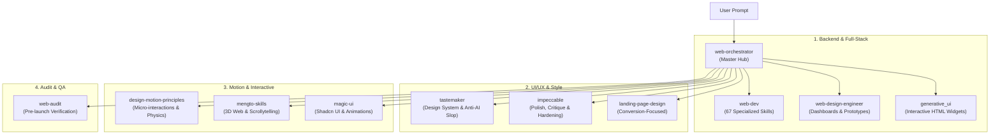

# 🌐 Antigravity Web Development & Design Skill Suite

ชุดสกิลสำหรับ **Google Antigravity & Gemini CLI** ที่รวบรวมขีดความสามารถการพัฒนาเว็บไซต์แบบครบวงจร ตั้งแต่ **Full-Stack Web Development, Backend Architecture, Database, DevOps** ไปจนถึง **UI/UX Design Systems, High-Converting Landing Pages, Motion Design, Interactive 3D Web และ Pre-Launch Web Audit** พร้อมระบบ **Master Orchestrator** ที่ช่วยนำทางและจัดสรรงานไปยังสกิลเฉพาะทางโดยอัตโนมัติ

---

## 📑 สารบัญ (Table of Contents)
- [ภาพรวมสถาปัตยกรรม (Architecture)](#-ภาพรวมสถาปัตยกรรม-architecture)
- [รายการสกิลทั้งหมด (Skill Directory)](#-รายการสกิลทั้งหมด-skill-directory)
- [ตารางการตัดสินใจเลือกใช้งาน (Decision Matrix)](#-ตารางการตัดสินใจเลือกใช้งาน-decision-matrix)
- [วิธีติดตั้งและใช้งาน (Installation & Setup)](#-วิธีติดตั้งและใช้งาน-installation--setup)
- [English Summary](#-english-summary)

---

## 🏛️ ภาพรวมสถาปัตยกรรม (Architecture)

ชุดสกิลนี้ถูกออกแบบตามแนวคิด **Orchestrator Pattern** โดยมี `web-orchestrator` ทำหน้าที่เป็น Hub ศูนย์กลาง เมื่อผู้ใช้ป้อน Prompt เกี่ยวกับงานพัฒนาเว็บ ระบบจะจับคู่ความต้องการและส่งต่อไปยังสกิลเฉพาะทางที่เหมาะสมที่สุดเพียงหนึ่งตัวในแต่ละขั้นตอน:



---

## 📦 รายการสกิลทั้งหมด (Skill Directory)

### หมวดที่ 1: Full-Stack & Core Web Development
| สกิล | เส้นทาง | คำอธิบาย |
|---|---|---|
| **`web-orchestrator`** | `skills/web-orchestrator/` | Master Router ตัวนำสำหรับงานเว็บทุกประเภท เชื่อมโยงทุกขั้นตอน |
| **`web-design-orchestrator`** | `skills/web-design-orchestrator/` | Orchestrator เฉพาะทางด้าน UI/UX, Frontend และ Motion Design |
| **`web-dev`** | `skills/web-dev/` | คลังรวม 67 Specialized Skills ครอบคลุม Next.js, React, Vue, FastAPI, NestJS, Django, Postgres, SQL, Docker, Kubernetes, Testing และ Security |
| **`web-design-engineer`** | `skills/web-design-engineer/` | สร้าง Visual Artifacts, Data Dashboards, Interactive Prototypes และ Style Recipes (25 สไตล์) |
| **`generative_ui`** | `skills/generative_ui/` | เรนเดอร์ Interactive HTML Widgets จำลองในหน้าแชทสำหรับทดสอบและพรีวิว |

### หมวดที่ 2: ออกแบบ UI/UX, สไตล์ และความสวยงาม (Anti-AI-Slop)
| สกิล | เส้นทาง | คำอธิบาย |
|---|---|---|
| **`landing-page-design`** | `skills/landing-page-design/` | ออกแบบหน้า Landing Page ที่เน้น Conversion, Copywriting, และ Hero Section ไร้ดีไซน์ AI ซ้ำซาก |
| **`tastemaker`** | `skills/tastemaker/` | ระบบจัดทำ Design Token, Color Palette, Asset Sourcing และ Anti-AI-slop Pipeline |
| **`impeccable`** | `skills/impeccable/` | ขัดเกลา ตรวจสอบ ปรับแต่ง Responsive, Layout, Accessibility พร้อมคำสั่งเฉพาะทางกว่า 20 คำสั่ง (`/polish`, `/critique`, `/shape`, `/live`) |

### หมวดที่ 3: Motion, Animation & Interactive 3D Web
| สกิล | เส้นทาง | คำอธิบาย |
|---|---|---|
| **`magic-ui`** | `skills/magic-ui/` | คลังคอมโพเนนต์ Magic UI สำหรับ React, Tailwind CSS และ Framer Motion (Particles, Bento Grid, Border Beam) |
| **`design-motion-principles`** | `skills/design-motion-principles/` | สร้าง Micro-interactions, Motion Curves และตรวจสอบ Animation Slop อิงหลักการของ Emil Kowalski และผู้เชี่ยวชาญ |
| **`mengto-skills`** | `skills/mengto-skills/` | เทคนิคระดับพรีเมียมจาก Meng To (Design+Code): Scrollytelling, WebGL, Three.js 3D interactions |

### หมวดที่ 4: ตรวจสอบคุณภาพก่อนปล่อยเว็บ (Pre-launch Audit & QA)
| สกิล | เส้นทาง | คำอธิบาย |
|---|---|---|
| **`web-audit`** | `skills/web-audit/` | เครื่องมือตรวจสอบความพร้อมก่อน Launch เว็บไซต์ (เช็ก Link เสีย, Accessibility, SEO/Copy, Mobile View, Performance) ทั้ง Local Code และ Live URLs |

---

## 🎯 ตารางการตัดสินใจเลือกใช้งาน (Decision Matrix)

| เมื่อคุณต้องการทำ... | สกิลที่เหมาะสม |
|---|---|
| พัฒนา Backend API, วางระบบฐานข้อมูล หรือคอนฟิก Docker | `web-dev` |
| สร้างหน้าขายของ / Landing Page สำหรับผลิตภัณฑ์หรือ SaaS | `landing-page-design` |
| วางระบบสี ออกแบบ Design System ไม่ให้ซ้ำแบบ Generic AI | `tastemaker` |
| รีวิว ตรวจสอบ และขัดเกลา UI แดชบอร์ดหรือเว็บแอพให้เนี้ยบ | `impeccable` |
| สร้าง Interactive Dashboard หรือ Prototype จำลอง | `web-design-engineer` |
| เพิ่มแอนิเมชัน นุ่มนวล มีจังหวะ Micro-interaction ที่เป็นธรรมชาติ | `design-motion-principles` |
| เว็บไซต์ที่มี 3D WebGL หมุนตามการเลื่อนหน้าจอ (Scrollytelling) | `mengto-skills` |
| ดึงคอมโพเนนต์สำเร็จรูปสวยๆ เช่น Bento Grid, Glow Effect มาใช้งาน | `magic-ui` |
| จำลอง UI widget ในแชทเพื่อลองเล่นก่อนเขียนโค้ดจริง | `generative_ui` |
| ตรวจสอบความถูกต้องและคุณภาพของเว็บทั้งหมดก่อนเปิดตัว | `web-audit` |

---

## 🚀 วิธีติดตั้งและใช้งาน (Installation & Setup)

### ติดตั้งลงใน Antigravity / Gemini CLI Configuration

คัดลอกโฟลเดอร์สกิลที่ต้องการ (หรือทั้งหมด) ไปยังโฟลเดอร์สกิลของระบบของคุณ:

```bash
# Clone repository
git clone https://github.com/Kawleaw/Kaw---antigravity-web-skill-design-backend-.git

# คัดลอกสกิลทั้งหมดเข้าสู่โฟลเดอร์สกิลส่วนตัว (สำหรับ Windows PowerShell)
Copy-Item -Path ".\Kaw---antigravity-web-skill-design-backend-\skills\*" -Destination "$HOME\.gemini\config\skills\" -Recurse -Force
```

### การเรียกใช้งาน
เมื่อติดตั้งแล้ว คุณสามารถเปิดใช้งาน Master Orchestrator ได้โดยตรง หรือเรียกใช้งานแต่ละสกิลผ่านบทสนทนา เช่น:
* `"ช่วยออกแบบระบบหลังบ้านสำหรับแอพ e-commerce ให้หน่อย"` $\rightarrow$ ระบบจะนำทางเข้าสู่ `web-dev`
* `"ช่วย audit หน้าเว็บนี้ก่อนขึ้น live ให้ที"` $\rightarrow$ ระบบจะเรียกใช้ `web-audit`

---

## 🌐 English Summary

This repository contains a curated, unified suite of **Antigravity Skills** for end-to-end Web Development and Web Design:
* **Master Orchestration:** Centralized routing via `web-orchestrator` and `web-design-orchestrator`.
* **Full-Stack Development:** 67 specialized workflows in `web-dev` covering modern frontend/backend frameworks, databases, DevOps, security, and testing.
* **UI/UX & Anti-AI Slop:** Purpose-built skills (`landing-page-design`, `tastemaker`, `impeccable`) providing distinct branding, design tokens, and rigorous UI auditing.
* **Motion & 3D Web:** Motion principles (`design-motion-principles`), 3D WebGL / Scrollytelling (`mengto-skills`), and modern animation components (`magic-ui`).
* **Quality Assurance:** Pre-launch web audits and verification via `web-audit`.

---
*Maintained by [@Kawleaw](https://github.com/Kawleaw)*
