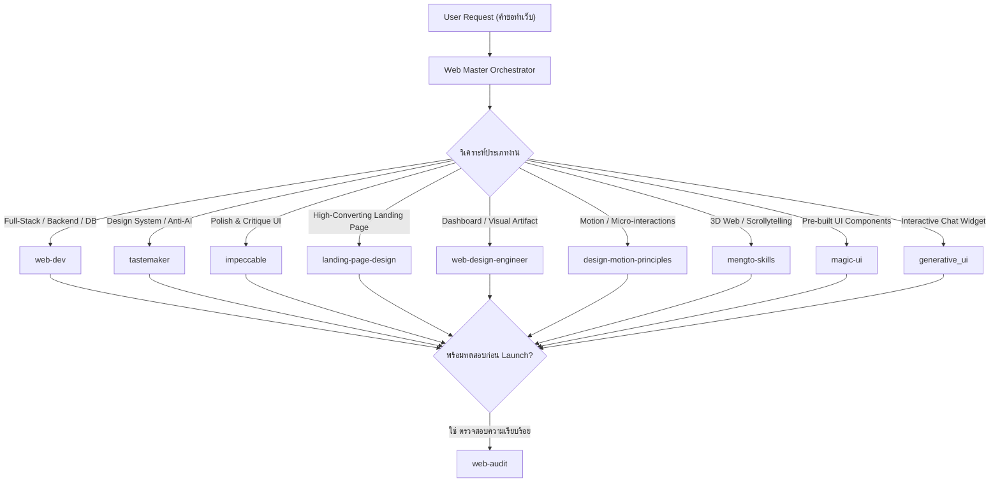

# Web Master Orchestrator (Full-Stack & Design)

สกิลนี้เป็น **Master Entry Point** สำหรับงานพัฒนาเว็บไซต์ทุกประเภท ตั้งแต่ Backend, Database, Full-Stack Architecture ไปจนถึง UI/UX Design, Motion Graphics, Interactive 3D Web และการ Audit ก่อนปล่อยเว็บขึ้น Production

> [!IMPORTANT]
> **แต่ละงานให้ route ไปสกิลเดียวเป็นหลักก่อน** เพื่อลดความสับสนและรักษา Context ให้คมชัด
> หากงานมีความซับซ้อนหลายขั้นตอน (เช่น ออกแบบ UI ก่อน แล้วค่อยต่อ Backend API) ให้วางแผนและรันทีละขั้นตอนตามลำดับ

---

## Decision Matrix — แผนที่เลือกสกิลตามประเภทงาน

| หมวดหมู่ | งานที่ผู้ใช้ต้องการ | สกิลที่ควรเรียกใช้ | หน้าที่หลัก / จุดเด่น |
|---|---|---|---|
| **Backend & Architecture** | Full-Stack, REST/GraphQL API, Database, Auth, Docker, Security, Testing | `web-dev` | คลัง 67 Specialized Skills ครอบคลุม Next.js, FastAPI, NestJS, Django, Postgres, SQL, DevOps |
| **UI/UX Design Engine** | Design System, Color Palette, Token generation, Anti-AI-slop, Asset Sourcing | `tastemaker` | ระบบดีไซน์ระดับโปร ป้องกันงานดูเป็น Generic AI, มีสคริปต์อัตโนมัติ |
| **UI Polishing & Audit** | ตรวจสอบ, ขัดเกลา, ปรับแต่ง Layout, Polish native app / dashboard | `impeccable` | 20+ คำสั่งย่อย (`/polish`, `/critique`, `/shape`, `/live`), ปรับ UX/UI และ Accessibility |
| **Landing Page** | ทำหน้า Landing Page ขายของ, SaaS marketing, Conversion-focused page | `landing-page-design` | เจาะลึก Hero Section, Objection Handling, Visual Hierarchy และ Copywriting |
| **Visual Artifacts** | สร้างหน้า Dashboard, Slide Deck, Interactive Prototype, Style recipes | `web-design-engineer` | 25 Style Recipes, Visual front-end creation, แดชบอร์ดข้อมูลแบบพรีเมียม |
| **Motion & Interaction** | แอนิเมชันในเว็บ, Micro-interactions, Physics transitions, ตรวจ Slop Motion | `design-motion-principles` | เทคนิคระดับโลก (Emil Kowalski, Jakub Krehel, Jhey Tompkins) |
| **3D Web & Interactive** | 3D WebGL, Three.js, Cinematic Scroll-driven storytelling, Video reverse eng | `mengto-skills` | เทคนิค Interactive ขั้นสูงจาก Design+Code (Meng To) |
| **Component Registry** | ใช้งาน UI Components สวยๆ เช่น Bento Grid, Particles, Border Beam | `magic-ui` | คลังคอมโพเนนต์ React / Tailwind CSS / Framer Motion สไตล์ Magic UI |
| **Interactive Widgets** | เรนเดอร์ HTML Widgets จำลองแบบ Interactive ในหน้าแชท | `generative_ui` | แสดงกราฟ ตัวควบคุม Interactive หรือ UI ทดลองแบบ Standalone |
| **Pre-launch QA & Audit** | ตรวจสอบเว็บไซต์ก่อน Launch จริง, เช็กลิงก์เสีย, SEO/Copy, Performance | `web-audit` | Checklist ครอบคลุมทั้ง Local Project และ Live Website URL |

---

## ขั้นตอนการทำงาน (Workflow)

---

## ตัวอย่างการจับคู่คำขอของผู้ใช้ (Prompt Matching)

* **"อยากทำ Backend API ด้วย FastAPI + PostgreSQL พร้อมระบบ Auth"** $\rightarrow$ `web-dev`
* **"ช่วยออกแบบหน้าเว็บให้ดูสวย มีเอกลักษณ์ ไม่ดูเป็นงาน AI โหลๆ"** $\rightarrow$ `tastemaker`
* **"รีวิวและเกลาหน้า Dashboard นี้ให้ดูเรียบหรูและใช้ง่ายขึ้นหน่อย"** $\rightarrow$ `impeccable`
* **"สร้าง Landing Page สำหรับโปรเจกต์ SaaS ตัวใหม่ เน้น Conversion"** $\rightarrow$ `landing-page-design`
* **"อยากเพิ่ม Micro-interaction นุ่มๆ และ Transition ตอนเปลี่ยนหน้า"** $\rightarrow$ `design-motion-principles`
* **"อยากได้เว็บสไตล์ Apple ที่เลื่อนหน้าจอแล้วโมเดล 3D หมุนตามสกรอลล์"** $\rightarrow$ `mengto-skills`
* **"ขอใส่ Bento Grid และเอฟเฟกต์แสงวิ่งตามขอบการ์ด"** $\rightarrow$ `magic-ui`
* **"ตรวจเช็กเว็บก่อนขึ้น Production ว่ามีลิงก์เสียหรือจุดบกพร่องตรงไหนไหม"** $\rightarrow$ `web-audit`
